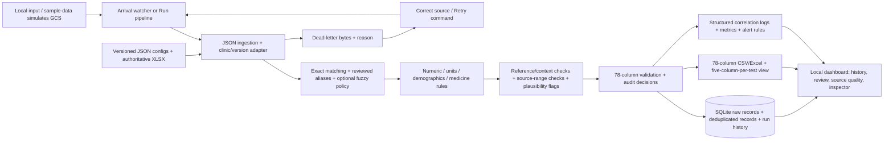
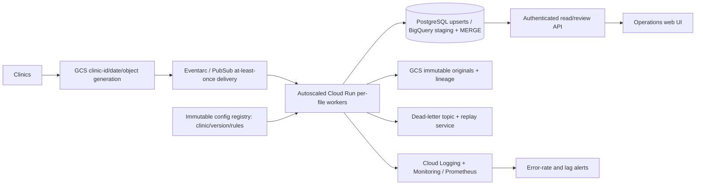

# Solution architecture

## Local working prototype

The prototype is a serial local batch application. Local folders simulate object storage as permitted by assignment section 3.2. `src.scheduler` detects changed arrivals/configurations; the UI and CLI can also initiate processing. Clinic format adapters use declarative paths, classifiers and schema versions. A new documented format is onboarded by editing JSON rather than changing extractors; tests demonstrate a third format from a configuration edit.

The source XLSX remains authoritative for the 78-column long-form output and existing test-name conflicts. Exact source occurrences are retained in `raw_records`, CSV/Excel and provenance. Configurable same-document suppression produces the analytical `medical_records` table. Cross-document similarity is reported, not suppressed, because supplied identifiers are redacted. A derived wide table and CSV provide exactly five columns per configured test; aligned JSON arrays preserve repeated tests. A separate index maps wide rows to file/section. Blank cells mean the test was absent, not that it was normal.

SQLite transactions make each canonical/raw table replacement atomic for the local snapshot. Stable IDs, source hashes, preserved ingestion timestamps, versioned source archives, decisions and occurrence history support idempotent reruns and audit. Two complete reruns are tested for unchanged CSV bytes and stable row counts. Run history intentionally adds a new operational attempt. Review state is persisted separately and does not alter medical source values. At-rest source material is retained; optional salted tokenization protects the dashboard, disables raw inspection/downloads, and requires an environment secret. It is not an encryption-at-rest or full regulatory-compliance claim.

Result processing only converts a complete numeric token or a numeric value followed by a verified unit. Unresolved combined values remain text with a review reason. Unit rules are test-specific, dimensional and versioned. Clinical classifications distinguish independently sourced reference rules, contextual applicability, document-supplied ranges and prototype plausibility screens. Unknown or redacted demographics do not receive an adult/sex-specific reference interval. Missing reference context is reported as Invalid/not assessable, not normal. All original analytics, names, units and results remain available.

## Production target (design, not deployed)

Use at-least-once delivery with uniqueness on object generation + source identity + occurrence path and transactional upserts. Acknowledge only after persistence; retries use bounded exponential backoff before dead-letter delivery. Isolate file processing so one malformed document does not stop other messages. Pin the configuration version at intake so replays are reproducible. Prefer PostgreSQL for transactional review and serving; add BigQuery for large analytical history. Use a staging/MERGE pattern for analytical batches, not per-record inserts.

## Capacity and tradeoffs

200,000/day averages 2.31 files/s; a 400,000/day burst averages 4.63 files/s. At an **assumed, unmeasured** 0.5 files/s per worker, 70% target utilization needs `ceil(4.63 / (0.5 * .7)) = 14` workers; provision a minimum illustrative burst target of 16 and benchmark realistic file sizes. The local batch loads multiple files in memory and is not the production worker. Production workers must process one bounded file at a time and stream oversized arrays. No 200k/day performance or 95th percentile SLA is claimed from five samples.

Budget the 15-minute objective as 2 minutes queueing, 10 processing, 2 storage and 1 serving; measure end-to-end object-event timestamps and P95, not just worker CPU time. Queue depth and oldest-message age drive autoscaling; enforce admission/size limits and downstream connection pools. Cloud Run is simpler for independent files; Dataflow is a future option for sustained streaming/complex windowing at higher operational cost. Local SQLite keeps the assignment easy to run but is not the multiworker cloud database.

See NFR notes, assumptions and source references for the remaining detail. Production deployment, clinical approval, 98% coverage and reviewer GitHub access are external release gates rather than prototype claims.
