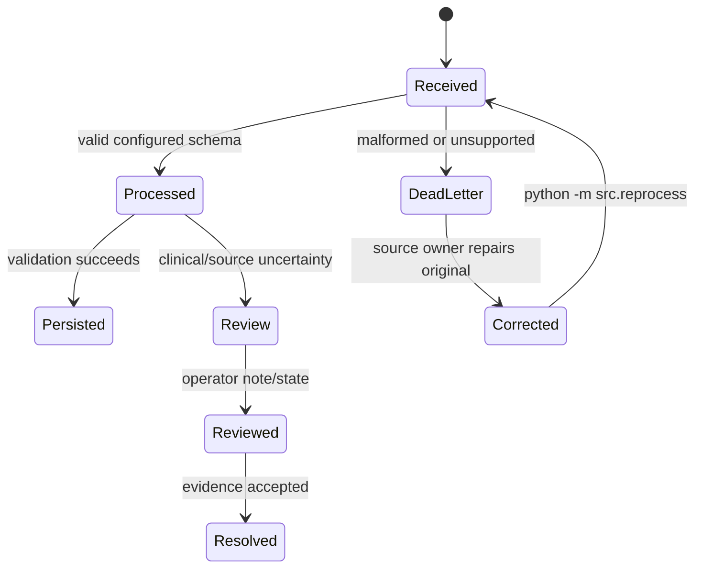

# Non-functional design and operational notes

| Requirement | Prototype evidence | Production approach / limit |
|---|---|---|
| Throughput/bursts/latency | Measured per-run duration, records/s and local arrival-lag proxy | Architecture sizing explicitly assumes worker capacity; load-test 200k/400k and measure true event-to-query P95 <=900s. |
| Horizontal scalability | Stateless transformations; local single-writer snapshot | Per-file autoscaled workers, backpressure, pooled DB connections, content/generation identity. SQLite prototype is not shared across workers. |
| Zero-code onboarding | clinics.json paths/classifiers + version selection; synthetic new-version test | Record clinic ID and profile version, immutable config snapshots, validate config in CI before activation. |
| One-day onboarding | Documented checklist | Obtain real sample schemas, units and clinical approval; timing depends on source-owner response. |
| Fault tolerance | Invalid JSON skipped; bytes and error retained; corrected originals retried | PubSub dead-letter topic, bounded retries, replay with event ID/config version, separate poison messages. |
| Idempotency | Stable row IDs/source hashes; same-input rerun has same CSV bytes; DB counts stable | Transactional object generation checkpoint, uniqueness constraints and upsert/MERGE. |
| Availability | Local server starts on demand | Two zones/regions as required, DB backups, health checks, deployment rollback; 99.5% not measured by this prototype. |
| 98% standardization | Both occurrence and distinct-variant coverage are reported and alerted | Owner review queue, curated dictionary releases, 30-day onboarding follow-up. Current supplied dictionary does not meet target; never disguise fuzzy suggestions as resolved matches. |
| Lineage | File, raw hash, section/child, clinic/profile, config hash and ingestion timestamps persisted | Real clinic/object ID from upstream authenticated route, append-only raw storage and controlled retention. Sample clinic IDs are labelled simulated. |
| PII | Optional keyed HMAC tokens in UI; raw view/downloads blocked when masked | Secret manager, RBAC, TLS, storage encryption, retention, access audits and applicable legal review. No blanket compliance claim. |
| Monitoring | /metrics Prometheus exposition; persisted metrics/alerts and history | Scrape metrics with Prometheus or Cloud Monitoring. Error rate >1% or lag >900s triggers notification routing; coverage is a review alert. No real notification destination is configured locally. |
| Structured logs | JSON events with run, correlation, document, record, clinic and source identifiers | Centralize structured events and traces; avoid medical payloads in logs, assign retention and access controls. |

## Clinic onboarding checklist

1. Obtain a deidentified payload, clinic identifier, schema version, units, date convention and document classifier list.
2. Copy a profile in `config/clinics.json`. Set detection, root/section/child paths and target field maps; `$root.` references envelope fields.
3. Add a non-overlapping filename/path route with the clinic ID, label and profile ID. Distinguish incompatible versions explicitly.
4. Add approved aliases, unit rules, medicines and clinical ranges with sources. Existing workbook conflicts cannot be overridden by alias JSON.
5. Add synthetic/deidentified fixture assertions; run the config, extraction, clinical and database tests. Review fuzzy suggestions and coverage before activation.
6. Pin config hash, run a shadow batch, inspect the raw/transformed UI and approve release. A new test roster only changes the XLSX and wide-test configuration, not Python.

## Failure and replay flow

Dead-letter metadata points to a verbatim `.source` byte copy. Repair the original in input, then run `python -m src.reprocess`; it retries the batch and marks only corrected, still-present sources resolved. Runtime failures return a nonzero exit code and logs; dead-letter capture covers ingestion/section processing failures. The local dashboard allows one run at a time. Do not run concurrent CLI writers against the same workspace.

## Rule governance

Lab intervals vary with method, age, sex and context. Bundled hemoglobin adult ranges require known adult age and sex; sodium adult ranges require adult age. The broad plausibility envelopes are labelled prototype review heuristics, not medical critical-value thresholds. These envelopes are independently testable on synthetic 0.1/999 examples, but require domain approval before actual claim adjudication. The software never recommends treatment or automatically approves claims.
